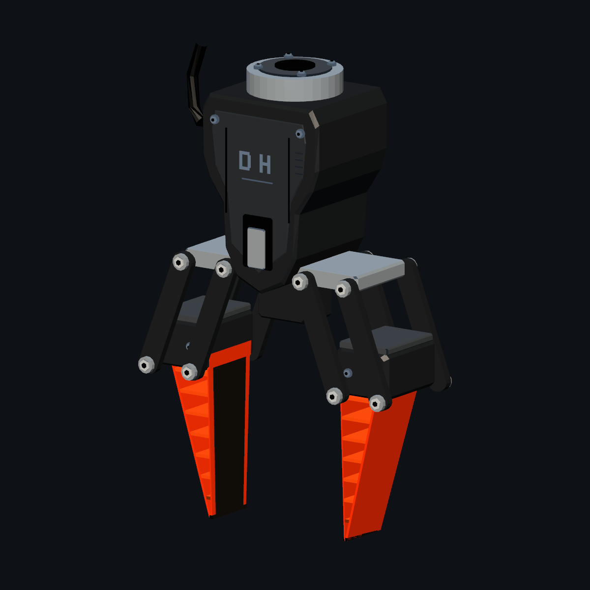
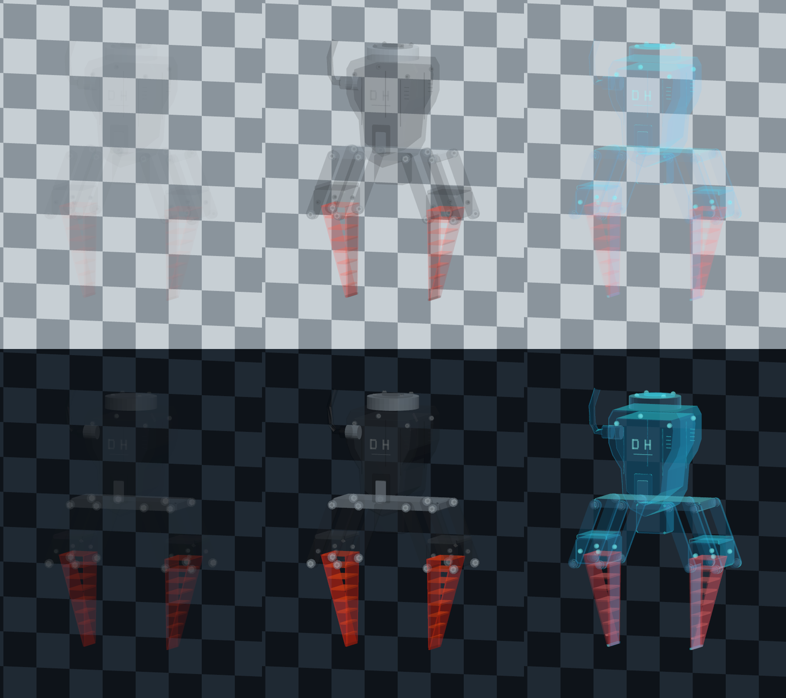

# AG-160-95 软指夹爪可视化

用于 Quest 3 机械臂策略后训练数据采集界面的未来夹爪状态显示。主场景 `Teleoperation` 的轨迹 ghost 与可选 Robot TCP ghost 均加载 `Prefab/AG16095SoftGripper`。原始 `GhostGripper` 仍保留，方便对比或回退。

## 来源与尺寸

机身外观根据项目根目录的 `gripper_realworld_image_1.jpg`、`gripper_realworld_image_2.jpg`，以及[大寰 AG 系列官方资料](https://www.dh-robotics.com/product/ag)重建。官方 AG-160-95 的总行程为 95 mm，原厂完整夹爪尺寸为 184.6 × 162.3 × 67 mm。照片中的自定义软指和连接件会改变整机外形，所以不直接把原厂整机包络当作安装软指后的包络。

这是供实时渲染使用的外观模型，不是厂家 CAD 或制造图。壳体、接头、连杆位置按照片和官方比例近似；四连杆表现平行夹持开合，不模拟接触物体后的包络自适应或硅胶形变。

橘红软指的完整网格包络严格按用户提供的 91.6 mm 长、39.55 mm 宽、27 mm 厚制作。三棱台采用截尖楔形近似，包含接触面、侧脊和八组分段筋条，前后侧具有实际开孔。暂按 8 mm 嵌入黑色连接件，露出长度约 83.6 mm；8 mm 是缺少实测插入深度时的建模假设。可修改 `EmbeddedFingerLength` 后重新生成；若实测连接件也有不同，还应调整构建器中的夹持件几何。

## 使用与坐标

- Prefab：`Assets/Resources/Prefab/AG16095SoftGripper.prefab`。
- 模型按米建模：局部 X 为开合方向，局部 -Y 指向指尖，Z 为机身厚度方向。局部原点为 TCP，位于法兰安装面沿 -Y 方向 200 mm；它沿用当前轨迹/TCP 根变换，不更改收到的数据。几何相对旧原点沿 Y 下移 8 mm，安装面处于根坐标 Y=0.200 m。
- 仍通过现有 `GripperJawController.jawWidth` 设置开口，单位为米。`AG16095GripperVisual` 在 LateUpdate 同步两侧指头与前后连杆；也可调用 `SetJawWidth` 或 `ApplyWidthNow` 立即更新预览。
- 可视开口限制为 0–0.095 m。负数夹到 0，超行程夹到 0.095；NaN/Infinity 回到闭合状态。各采样点的独立实例继续使用各自的预测 width，未改动 UDP/BSON 数据结构。
- 显示参数：轨迹点 `pointSize=0.005`、两种 ghost `scale=0.25`、主场景旋转偏移 `(-90,0,0)`，运行时使用原色和 Alpha 0.75。缩放以模型 TCP 原点为中心；模型内法兰到 TCP 为 200 mm，显示为 50 mm。轨迹点仍与 TCP 重合，轨迹坐标不缩放。
- `GripperPreview.unity` 展示原尺寸的 0 mm 和 95 mm 开口，不加入 Android Build Settings，也不启动主场景的网络线程。

## 结构和渲染

黑色倒角机壳、凹入面板、法兰、侧面插头及短线缆、平行连杆、六角螺栓和软指分别组合进四个共享 Mesh 资源。左右指头独立移动，四组前后连杆跟随关节转动并保持 64 mm 的模型连杆长度。整个 Prefab 共 7 个 MeshRenderer、6,264 个三角面，无纹理资源、无碰撞体。

单个共享顶点色材质表达外壳、金属、软指和接触面，减少多材质子网格。Prefab 和生成器使用第一版 `AG16095Surface.mat`：黑灰机身、橙色软指。单独预览 Prefab 使用实体材质，运行中的两种 ghost 使用 75% 不透明度。旧蓝色材质 `AG16095GhostSurface.mat` 作为对比资源保留。`ARISE/Gripper Vertex Color` 提供 Built-in 管线光照、混合/深度状态和单通道实例化立体宏；已有 ghost 代码仍可设置 `_Color.a`、混合模式及透明渲染队列。顶点 alpha 用作金属高光权重，不作为 ghost 透明度。面数和 Renderer 数仅是资源统计，不替代 Quest 真机帧率测量。

## 历史实验：蓝色透明外观

只修改 Alpha 不足以得到清晰的未来状态显示，当前代码中有三个具体原因：

- Opaque 材质使用 One / Zero 混合并写深度，单改颜色 Alpha 不会开启透明。
- `ApplyGhostAppearance` 与 `ApplyRobotGhostAppearance` 在实例创建时复制材质，并用组件字段覆盖 Alpha。当前场景字段为 0.75，调整 Prefab 的颜色 Alpha 会被覆盖。
- 普通 Alpha 混合也会一起淡化黑色机身和高光。0.05 表示单层只有 5% 不透明度，黑色主体尤其容易消失。透明面通常不写深度，模型内部多层结构也会叠色，不能只靠一个 Alpha 数字改善轮廓。

旧蓝色材质采用轻量的 Fresnel 风格视角边缘效果：表面正面更透，掠视边缘更明显，黑灰金属偏青蓝色，饱和橘红软指保留颜色。它是可透视的示意渲染，没有折射、屏幕拷贝或真实玻璃的光学模拟。原有双眼立体渲染宏保持不变。

| 调整位置 | 蓝色版历史值 | 作用 |
| --- | --- | --- |
| Main / ChunkVisualizer / Ghost Alpha | 0.28 | 轨迹 ghost 的透明度上限；运行时覆盖材质 Alpha |
| VisualizationServer / Robot Ghost Alpha | 0.28 | Robot TCP ghost 的透明度上限 |
| Ghost 材质 / Interior opacity multiplier | 0.22 | 正面表面约为 0.28 × 0.22 = 0.0616；边缘逐渐升至 0.28，叠层后屏幕结果仍会累积 |
| Ghost 材质 / Future state tint | (0.15, 0.75, 1) | 青蓝色调 |
| Ghost 材质 / Tint strength | 0.65 | 金属机身的染色强度 |
| Ghost 材质 / Preserve soft finger color | 0.85 | 保留橘红软指颜色 |
| Ghost 材质 / Edge highlight power | 2.4 | 边缘高光的宽窄 |
| Ghost 材质 / Edge highlight brightness | 1.1 | 边缘亮度 |

当前可在组件上调整原色 ghost 的 Alpha。运行中的实例持有材质副本，调整后需重新创建 ghost 或重新进入 Play 才能应用。旧蓝色材质不参与当前 Prefab 和运行时渲染。

当前通过明暗棋盘背景的真实 Unity 渲染检查了透视效果；桌面截图不能替代 Quest 3 透视背景、双眼显示和多夹爪叠加时的真机检查。普通透明面的排序限制仍然存在。

## 原版恢复

`Assets/Resources/Prefab/GhostGripper.prefab` 和 `.meta` 从 `ARToolHand_APP_COPY` 恢复。Prefab 自身 GUID 保持 `e560002366ef8ee4fbfa225d1f3436bd`，仅将 Prefab 内的夹爪脚本、BlackMaterial、OrangeMaterial 三个旧 GUID 重映射为当前工程的 GUID；没有恢复覆盖现有依赖的 `.meta` 或改动当前场景的材质引用。

恢复后的旧 Prefab 已通过 Unity MCP 验证 Resources 加载、脚本和左右指头引用、三个 Renderer 材质以及 0 / 42.5 / 85 mm 输入时的旧版位移映射。旧模型保留旧开合行为；新的 AG-160-95 模型采用正确的 0–95 mm 平行开口，不继承旧版反向视觉映射。

`.gitignore` 中添加了针对这两个 Prefab、新模型 Mesh/材质/Shader、编辑器构建器、预览场景、主场景覆盖参数，以及必要脚本和材质元数据的例外。其余项目范围的忽略规则未批量修改。

## 重新生成与检查

Unity 菜单：

1. `Tools > ARISE > Gripper > Rebuild AG-160-95 Prefab`：更新网格，保留已有生成资源的 GUID。
2. `Tools > ARISE > Gripper > Render Reference Views`：生成主视、侧视和三种开口截图，输出到 `Docs/Images/`。
3. `Tools > ARISE > Gripper > Create Preview Scene`：保存独立预览场景，随后返回当前主场景。
4. `Tools > ARISE > Gripper > Render Transparency Comparison`：通过 Unity Camera 实际渲染明暗棋盘背景上的透明对比图，不修改主场景。

编辑器构建器中的 `Validate()` 会实例化临时预览对象，检查软指实际顶点包络、闭合不相交、缺失脚本/材质、多个开口和异常输入、两根平行杆长度。验证结果位于 `Logs/GripperUpgrade/2026-10-26/geometry-validation.json`。还通过现有 `ChunkVisualizer` 的实际材质初始化与 width 更新方法验证了新模型兼容性：输入 47.5 mm 得到 47.5 mm 模型接触面间距，两条初始化路径的 7 个 Renderer 均使用 0.28 Alpha、新的 future state 表面、SrcAlpha / OneMinusSrcAlpha 混合、ZWrite=0 和透明队列 3000。

透明效果调整前的 Android 构建已通过：Unity MCP 作业 `build-ff8bfc0f59`，2026-10-26 17:11:48（北京时间）完成，耗时约 12.2 秒，0 个错误、22 条警告。目标为 Android / IL2CPP / ARM64，唯一构建场景为 Teleoperation。APK 为 `Build/Android/ARISE_AR_APP-AG16095.apk`，大小 54,420,486 字节（约 51.9 MiB），SHA-256：`e63fa3110f61473b2708e3b4a37090398ed94d60d6093ae700ff8f5cd128740e`。

使用 Unity 自带 JDK 和 Android SDK 的 apksigner 验证通过（v2 签名、1 个签名者）；ZIP 校验通过。包内确认包含新模型名、`AG16095GripperVisual` 类型及 `ARISE/Gripper Vertex Color` 着色器，原生库仅有 arm64-v8a；最低 API 29，目标 API 34。Unity BuildReport 的 `total_size_mb=741.03` 是构建统计，不能当作最终 APK 文件体积。

原版恢复记录、网格验证、构建作业结果和 APK 校验收据位于 `Logs/GripperUpgrade/2026-10-26/`。未进行 Quest 头显安装或实际机械臂数据采集验证。

## 透明效果构建验证（2026-10-26）

Unity MCP 作业 `build-363b4efdb4` 成功，17:40:10（北京时间）结束，约 25.7 秒，0 个错误、29 条警告。新夹爪 Shader 的编译消息为空；构建日志中的警告涉及已有 BSON 接口、EyeAnchor 空脚本、Meta 功能组合、Plane Shader、XR Simulation 路径及 Apple Silicon lightmapper。

产物：`Build/Android/ARISE_AR_APP-AG16095-Ghost.apk`，54,427,560 字节，SHA-256 `87bdab546139213b0a9527cbf11cf08ce0b5a1389f01e320fc4886f1fd4648ac`。ZIP 完整性检查及 APK v2 签名验证通过，原生库仅含 arm64-v8a。调整前的 APK 保留。证据与修改前备份在 `Logs/GhostAppearance/2026-10-26/`。

渲染模式区别可参阅 [Unity Standard Shader Rendering Mode 官方说明](https://docs.unity.cn/2021.1/Documentation/Manual/StandardShaderMaterialParameterRenderingMode.html)，透明物体的深度写入关系见 [Unity 2022.3 ZWrite 官方说明](https://docs.unity3d.com/2022.3/Documentation/Manual/SL-ZWrite.html)。

## 2026-11-08 TCP 基准更新

法兰基准、缩放恢复及键盘校准微调的说明与验证见 [本次修改记录](Calibration_TCP_2026-11-08.md)。
