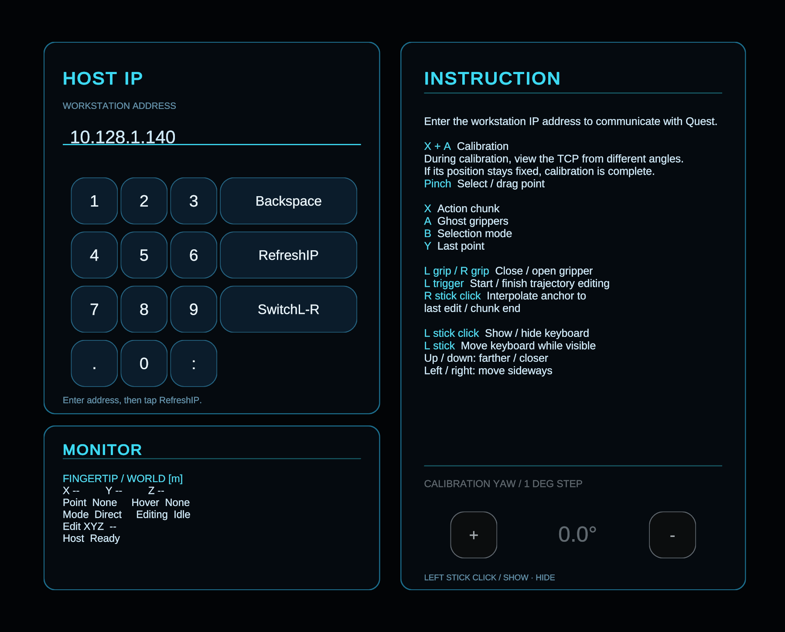

# Quest 键盘控制台

`Assets/Resources/Prefab/Keyboard.prefab` 分为左上 Host IP、左下 Monitor、右侧 Instruction，使用深蓝面板、青色描边、统一字体和按压/悬停反馈。沿用原来的 Meta Poke 按钮和 15 个操作回调，无额外贴图或第三方依赖。

## 使用

- 初始关闭。按下左手摇杆切换显示/隐藏，校准模式下同样可用；校准重置只使用右摇杆按下，避免冲突。
- 每次打开时出现在头部水平前方 0.45 m、下方 0.22 m，面向用户。打开后不跟随头部或右手移动；关闭后再次打开才重新定位。显示期间可拨动左手摇杆：下拉靠近、上推远离、左右横移，斜推同时沿两个方向移动；方向以当前头部水平朝向为参考。松杆后保持世界位置和朝向，隐藏时不移动，普通模式与校准模式均可使用摇杆移动。默认速度为 0.25 m/s，死区 0.2，前后范围 0.25–1.5 m，左右范围 ±0.8 m；前后是视线水平投影距离，不是头部到面板的三维直线距离。`MyKeyboard.summonDistance` 与 `summonDrop` 可调整这两个距离。
- Host IP 只保留一个可编辑地址，启动时直接取 `VRController.ip`。数字、小数点、冒号、Backspace、RefreshIP、SwitchL-R 保持原有用途。RefreshIP 验证地址后更新发送目标；无效地址保留原目标，监控台显示提示。
- Monitor 显示食指尖世界坐标（米）、选中点和悬停点索引、选择模式、编辑状态和编辑点坐标。无追踪数据时显示 `--`，不把零坐标当成有效追踪；跳变时沿用橙色提示。
- Instruction 第一条为 “Enter the workstation IP address to communicate with Quest.”，其后保留原有软件快捷键指南。说明直接保存在 Prefab 中，运行时也会更新；不再混入 IP 行。

## 资源和备份

- 当前 Prefab：`Assets/Resources/Prefab/Keyboard.prefab`，GUID 保持原值。
- 原 Prefab 备份：`Assets/Backups/Keyboard/Keyboard-before-redesign-20261026.prefab`。原布局和依赖绑定保持一致；Unity 复制时更改了根对象名，脚本更新后自动补充了三个新字段的默认值。备份在 Resources 之外，不进入 Resources 打包范围。另有 `Docs/Backups/Keyboard-before-redesign-20261026.zip`，保留原 Prefab/meta、脚本和主场景的逐字节原件。
- 原始 Prefab、meta、脚本和主场景的逐字节快照位于 `Logs/KeyboardRedesign/2026-10-26/before/`。备份 Prefab 用于保留旧界面；完整回退行为还需使用相应旧脚本。
- 编辑器生成器：`Assets/Editor/KeyboardTools/KeyboardPrefabBuilder.cs`。菜单 `Tools > ARISE > Keyboard > Rebuild Console Prefab` 重建界面；`Render Console Preview` 生成实际 Unity 相机渲染图。
- `Repair Console Rendering` 只修复现有 Prefab 的绘制层级和字体，保留布局、距离及回调。背景、按键面、按键字、Canvas 文字分别使用 sortingOrder 0、1、2、3；Canvas 开启 overrideSorting。两类现有 shader 都不写入深度，不能只靠透明物体的观察距离排序，否则换观察角度时背景会覆盖内容。继续使用正常深度测试，保留场景实体对键盘的遮挡。
- 字体按明确路径使用静态 `LiberationSans SDF.asset`；不再取 `FindAssets` 的第一个结果（原先实际取到了动态 Fallback 字体）。现有键盘字符均在静态图集中。
- 主场景在应用新 Prefab 时移除旧键盘实例的布局/回调覆盖，重新绑定 Client、监控文字及当前 IP。轨迹、夹爪和网络消息结构保持原样。

## 验证

Unity MCP 在隔离预览场景中执行了 17 项行为验证：默认关闭、头部偏移、朝向用户、头部移动后位置不变、关闭时控制器仍活动、再次唤出重新定位、全部 Poke surface 与回调绑定、数字键实际 UnityEvent、退格和空退格、刷新 IP、无效 IP、左右切换、实时 fingertip/选点监控、说明首句、UI 文字高度及缺失脚本检查，全部通过。

证据：`Logs/KeyboardRedesign/2026-10-26/behavior-validation.json`。这是运行实际组件和 UnityEvent 的编辑器内检查，不替代 Quest 3 上手指触碰、可达距离和清晰度验证。

Android 编译打包成功：Unity MCP `build-de8c747c1a`，65.6 秒，0 错误、28 条警告。APK：`Build/Android/ARISE_AR_APP-KeyboardConsole.apk`，54,434,380 字节，SHA-256 `5e81880fa3e8993781fd42a69daf24a82348fd6897519996c3c1681c635b1b80`。ZIP 完整性与 APK v2 签名验证通过；未安装到头显。构建警告涉及现有 BSON、EyeAnchor、Meta 配置、Plane Shader、XR Simulation 和 lightmapper。

### 0.1.2 绘制修复

在隔离预览场景中复现了随角度变化的面板/内容遮盖，并保存相同相机下修复前后的图像。修复后从 8 组相机位置（包括左右眼偏移、斜视角、0.25 m 和 1.5 m 深度）渲染，与隐藏所有背景/键面后的文字参考图逐像素比较；每组明亮文字像素被遮盖数量均为 0。静态字体字符覆盖、15 个 release 回调目标、IP 增删、默认隐藏和 0.45 m 距离检查通过。证据位于 `Logs/KeyboardRendering/0.1.2/`；这些是编辑器渲染检查，实际头显佩戴效果仍需体验确认。

### 2026-11-08 校准微调

Instruction 下方加入灰态/活动态的 `+ 角度 -` 板块，校准期间按 1° 微调实际世界 Y 轴航向角，原点不移动。说明已加入从不同视角观察 TCP 的英文指南。见 [修改与验证记录](Calibration_TCP_2026-11-08.md)。

### 2026-11-15 轨迹地图手势

切换到放大的轨迹地图后，用裸左手拇指和食指捏合拖动地图，松开即停。缩放使用握在右手的 Touch 控制器：右摇杆推上放大、拉下缩小、回中停止。拿起控制器或停止拖点后，须先让摇杆回中。右手捏合拖点时地图冻结；重开恢复默认位置和 3× 放大。右摇杆按下仍用于原有功能。

43 项 Unity 编辑器检查通过，包括两种手势、拖点冻结、失去追踪、重开复位、选点与原轨迹坐标回算、夹爪外观及说明排版。证据见 `Logs/TrajectoryMapGestures/2026-11-15/`。手势灵敏度需在 Quest 3 上实测。

单独按下再松开 A 切换夹爪显示，单独按下再松开 X 切换轨迹显示。A 和 X 同时按住时仅切换校准状态，不触发显示切换。0.1.8 的 53 项编辑器验证见 `Logs/Releases/0.1.8/validation.json`。

### 0.1.9 裸手与控制器隔离

按实际握持状态分别处理左右输入，放下实体控制器后不再向工作站发送该设备的按键或扳机输入。输入来源切换或失焦后先回到中立状态，才读取新按键。保留原有消息格式：布尔字段按物理键位，`LRinverse` 仍只交换两路模拟扳机轴。若要定位轨迹消失，可用 `sh Tools/quest-adb.sh logcat -s Unity` 观察 `[ARISE Input]` 中的左右来源、按键位掩码、扳机、捏合、编辑状态、本地显示和接收到的轨迹点数。
